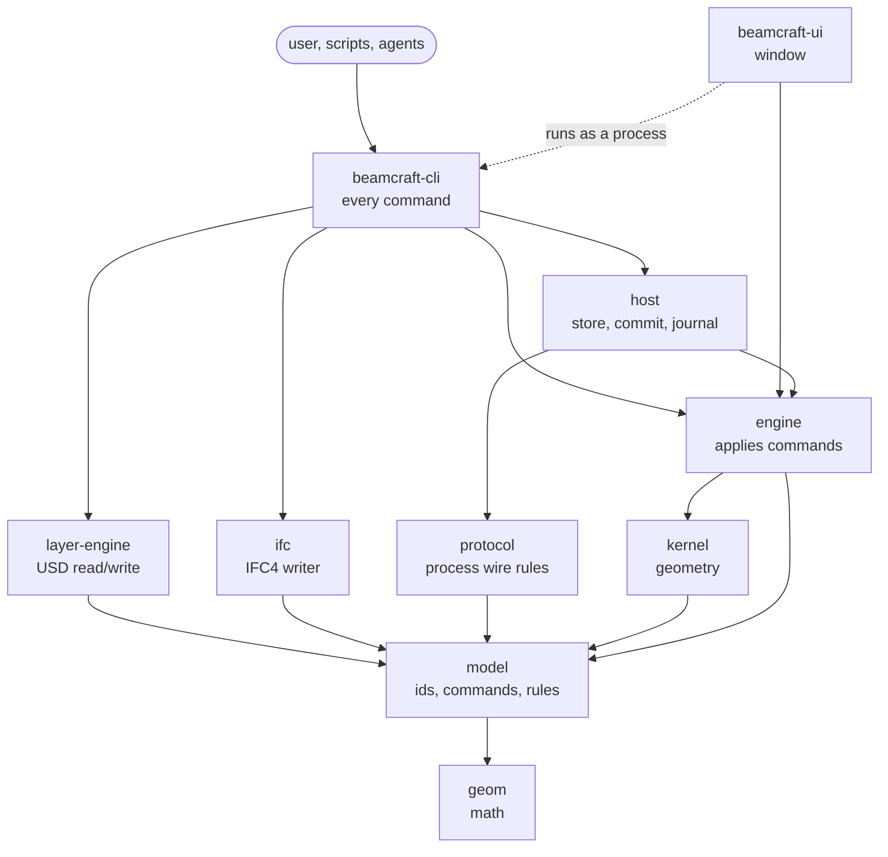

# Architecture

Two parts: how the application is built, and how a project is stored. What each task delivered is
in its note under [`design/`](design/); the plan is in [`plan/`](plan/README.md).

# Part 1. The application

## Principles

- **USD is the model.** There is no second saved format. Everything the user authored and
  everything the program computed lives in USD layers; in-memory indexes and snapshots are derived
  from them and thrown away.
- **Headless first.** Every feature is an engine API, then a CLI command, then an end-to-end test.
  The window is a client of the same commands; it holds no engineering logic.
- **Own engineering core.** Geometry (extrusion, cuts, holes, volumes) and every engineering rule
  are our own Rust code. USD parsing uses the pure-Rust `openusd` crate behind our wrapper.
- **Never crash on input.** Files, arguments and keystrokes are untrusted; every input is bounded
  and refused with a stable error code instead of a panic.
- **Units:** millimetres and radians, right-handed, Z up. Conversion happens only at the edges.

## Layers of code

Dependencies point one way, down the table. `beamcraft-boundaries` checks this in CI.

| Layer | Crate | What it does |
|-------|-------|--------------|
| 0 | `geom` | Points, vectors, planes, rigid transforms, tolerances, canonical f64 encoding |
| 1 | `model` | Identities (UUIDv7, SHA-256), commands and their validation, definitions, section families, error codes, limits |
| 2 | `kernel` | Geometry kernel: plate and member bodies, profile extrusion, plane cuts, through holes, meshes, exact volumes and measurements |
| 2 | `layer-engine` | Our wrapper over `openusd`: reads and writes the project's USD layers, the schema, validation and the UUID index |
| 2 | `protocol` | Wire rules (frames, limits, codes) for a separate USD process; no I/O |
| 2 | `ifc` | IFC4 STEP writer and GlobalId encoding; no file system |
| 3 | `engine` | Applies commands: builds the new authored state, asks the kernel for bodies, computes quantities, footprints, numbering, picking and the view snapshot |
| 4 | `host` | Disk: content-addressed blobs, atomic revision commit, journal and recovery, workspaces' storage, coordinator, compaction |
| 5 | `beamcraft-cli` (binary `beamcraft`) | Every user command; ties the crates together |
| 5 | `beamcraft-ui` (binary `beamcraft-ui`) | Native window: viewport, tools, properties panel |

`geom`, `model` and `kernel` are pure: no file system, OS or runtime, and they build for WASM. The
rest is desktop-native.



Arrows point from a crate to what it uses.
Some direct edges to `model` and `geom` are left out for readability; the exact table is in the
[module boundaries](contracts/f08-module-boundaries-v0.1.md).

## What happens on a command

Every editing command (`create-plate`, `create-member`, `update-element`, `copy-element`,
`delete-element`, `create-bolt`, `numbering-approve`, ...) follows the same path:

1. **Parse and validate.** The CLI turns arguments into a typed `model` command. Bad numbers,
   limits, identities and references are refused here with an error code; nothing is read yet.
2. **Open the head.** `host` finds the current revision and its manifest, verifies every layer
   blob by SHA-256, and `layer-engine` reads the authored layer into a model.
3. **Replay check.** Each command carries an `op_id`. If the journal already holds the same
   `op_id` with the same content, the earlier result is returned; with other content it is
   refused (`OP_ID_REUSE`). A retried command is therefore safe.
4. **Apply in memory.** `engine` builds the new authored state and asks `kernel` for the bodies of
   the elements it touches. Volumes, masses and their signatures are computed. The command also
   declares its **footprint**: what it reads and writes, element by element.
5. **Write layers.** `layer-engine` renders the new `authored.usda` and `derived.usda`; it checks
   that what it wrote matches the footprint.
6. **Commit.** `host` stores the new layers as blobs, writes an intent to the journal, writes the
   manifest and switches the head with one atomic, non-replacing file operation that also checks
   the expected base revision. Then the outcome goes to the journal.
7. **Verify.** The new revision is read back; the kernel re-evaluates every element and compares
   the stored meshes. A revision that does not verify is never the head.

A crash at any step leaves either the old or the new complete revision; `revision-recover` closes
an interrupted commit. Read commands (`plate-inspect`, `definitions`, `numbering-preview`,
`export-ifc`, `bom-export`, `pick`, `view-export`, ...) do steps 1–2 only.

## The window

`beamcraft-ui` does not open USD. It starts `beamcraft view-export` as a separate process, receives
a bundle (element-local meshes, placements, bounds, ids), re-validates it, and draws each distinct
mesh once with one instance per element. A click becomes a ray, and `beamcraft pick` decides what
was hit. Create, move, copy, delete, property edits, undo and publish run the same CLI commands a
user would type; the window shows the result or the engine's refusal as it is.

## Geometry

The kernel builds closed triangle meshes:

- **Plate:** a simple counter-clockwise contour in its local plane `z = 0`, extruded by its
  thickness.
- **Member:** a section profile (rectangle, nine rolled families or a custom outline with cavities)
  extruded along the axis from start to end point, oriented by a fixed frame rule and an optional
  roll.
- **Operations:** through holes in plates (round holes as regular polygons), one plane cut per
  element. Volumes come from certified meshes or exact formulas, never guessed.

Member quantities are `section area × length × density`, with the area from the catalogue entry or
the exact formula. Every quantity has a status: `current`, `stale` (its inputs changed) or
`unknown` (for example no density); `unknown` is never shown as zero.

# Part 2. The project on disk

## The store

A project is a directory, the **store**. It is not a single `project.usda`: every file is kept
once under its SHA-256, and a revision is a list of which file plays which role.

```text
project/
  blobs/<2 hex>/<64 hex>      every file ever written, named by its SHA-256, never changed
  revisions/00000000000000000070   one small record per revision: sequence, revision id, manifest digest
  ledger/outcomes.log         journal: intent and outcome of every commit, used for replay and recovery
  maintenance.lock            held during compaction
```

The record with the highest number is the head. It names a **manifest** blob:

```text
beamcraft-revision-manifest 1
project 01a15a4d-...            ProjectId
workspace 01a15a4d-...
revision 01a15a67-...           this revision's UUID
op 01a15a67-...                 the command that produced it
sequence 70
base 01a15a67-... <manifest>    previous revision
schema f351bf3e...              schema digest
root root.usda
layers 3
layer authored authored.usda 1f8e2db8... 72014
layer derived  derived.usda  c08abe4c... 351251
layer authored root.usda     f8c94cec... 320
```

Copying the three named blobs out under their names gives an ordinary USD project that any USD
program opens. Old revisions stay in the store for undo and history until `history-compact`
removes them; identical files are stored once.

A **workspace** (personal draft) is a store of its own, forked from a published revision, with a
`workspace.json` naming its base. Edits go to the workspace; `workspace-publish` moves them to the
published store fast-forward only. Undo and redo add new revisions that restore earlier layers.

## The layers

```text
root.usda        units (metersPerUnit = 0.001, upAxis = Z), ProjectId, schema digest,
  │              subLayers = [authored.usda, derived.usda]
  ├─ authored.usda   what the user decided: elements, parameters, placements, relationships
  └─ derived.usda    what the program computed: meshes, volumes, masses, their signatures
```

`authored.usda` is stronger than `derived.usda`. `derived.usda` only adds `over` opinions under the
same element paths, so deleting it loses nothing that cannot be recomputed. A read-only foreign
model, when attached, is a third role, `external`, stored byte for byte and never written.

## Prim hierarchy

```text
/World                                  Xform, kind = assembly
  /Definitions                          immutable definitions, one per content digest
    /D_<sha256>                         material or profile; displayName = "S355", "I 300x150"
  /Steel                                kind = group
    /E_<uuid without dashes>            one element; kind = component; displayName = its name
      /Geometry                         Mesh, kind = subcomponent (in derived.usda)
```

An element's prim name holds all 32 hex digits of its UUIDv7, so the path never changes; a rename
changes only `bim:name` and `displayName`. Every element kind lives under `/World/Steel`: plates,
beams, columns, assemblies, connections (welds and bolt groups), levels and reference wrappers.

## Attributes

Two namespaces: `bim:` for anything common to building elements, `steel:` for steel detailing.
All values are explicit attributes, readable without registering a schema.

**Every element** (`authored.usda`):

| Attribute | Meaning |
|-----------|---------|
| `bim:id` | UUIDv7, the identity |
| `bim:name` | user label |
| `bim:elementKind` | `plate`, `beam`, `column`, `assembly`, `connection`, `level`, `reference` |
| `bim:schemaVersion`, `bim:geometryMode`, `bim:createdBy` | schema version, mode, creating operation |
| `xformOp:translate`, `xformOp:orient` | placement (millimetres, quaternion) |

**By kind:**

| Kind | Attributes and relationships |
|------|------------------------------|
| Plate | `steel:plate:contourPointsMm`, `steel:plate:thicknessMm`, holes `steel:plate:holePointsMm` + `steel:plate:holeVertexCounts`, `bim:material` → definition |
| Beam, column | `bim:axisPointsMm` (start, end), `steel:member:rollRad`, `bim:profile` → definition, `bim:material` → definition |
| Plate cut (plate, beam, column) | `steel:cut:pointMm`, `steel:cut:normal`; the side the normal points to is removed |
| Assembly | no body; parts point to it |
| Weld | `steel:weld:type`, `:sizeMm`, `:location`, `:side`; `bim:connects` → [main part, secondary part] |
| Bolt group | `steel:bolt:diameterMm`, `:count`, `:pitchMm`, `:originMm`, `:directionMm`; `bim:connects` → [main, secondary] |
| Level | `bim:elevationMm` |
| Reference | wrapper placement and source pin; the foreign model is composed below it, read-only |

**Relationships on a part:** `bim:partOf` → its assembly, `bim:level` → its level.

**Numbering** (after `numbering-approve`): `steel:numbering:series`, `steel:numbering:number`,
`steel:numbering:basis` on each part and assembly.

**Definitions** (`/World/Definitions/D_<sha256>`): `bim:definitionKind` (`material`, `i_shape`,
`channel`, `rhs`, ...), the values (`bim:densityKgM3`, `steel:profile:hMm`, `:bMm`, `:twMm`, ...),
`bim:contentDigest`. The prim name is the SHA-256 of the content, so a definition never changes;
an element pins exactly the definition it was built with.

**Derived data** (`derived.usda`, on `.../E_<uuid>/Geometry`): the mesh (`points`,
`faceVertexCounts`, `faceVertexIndices`, `extent`, normals), and the quantities `bim:volumeMm3`,
`bim:massKg` with `bim:volumeStatus`, `bim:massStatus`, `bim:shapeKey`, `bim:shapeSignature`,
`bim:massSignature` and `bim:quantityAlgorithm`. A signature is the hash of the inputs a value was
computed from; when the inputs change, the stored value reads as `stale`.

## What is not in the project yet

- Visual appearance: no `material:binding` or `displayColor`, so other USD viewers show grey parts.
- Payloads and instancing: every mesh is written into `derived.usda`, which is rewritten on every
  edit.
- Cuts and holes are element attributes; the contract moves them to separate operation records.

## Where to read more

- [Model and commands contract](contracts/f04-model-and-commands-v0.1.md): identities, commands,
  errors, limits.
- [Geometry and viewport contract](contracts/f06-geometry-contract-v0.1.md): kernel inputs, meshes,
  frames, keys, picking.
- [Module boundaries](contracts/f08-module-boundaries-v0.1.md): the exact crate table CI enforces.
- [IFC export contract](contracts/e01-ifc-export-v0.1.md): what goes to IFC and what is lost.
- [`docs/development.md`](development.md): building and testing.
